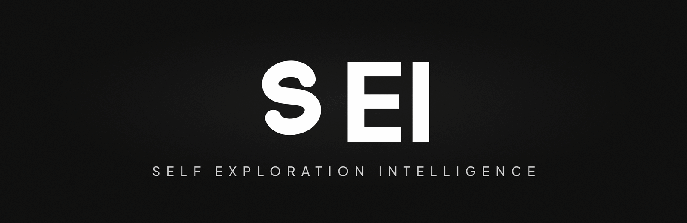
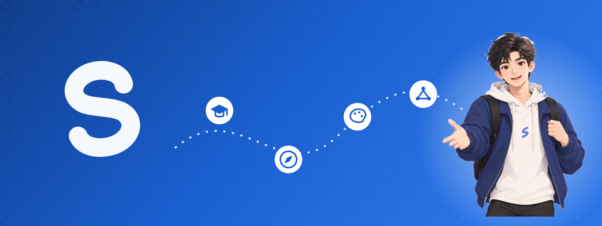
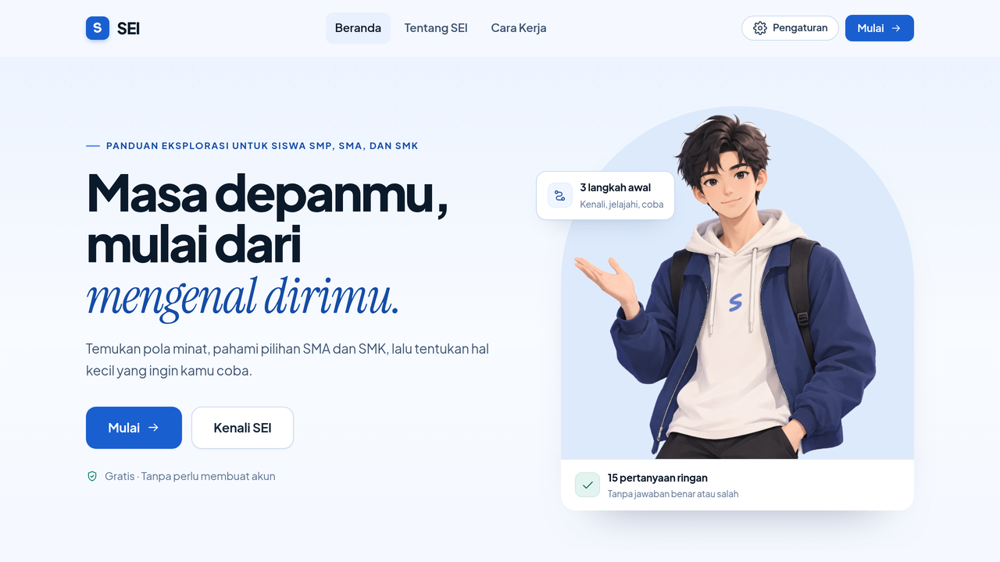
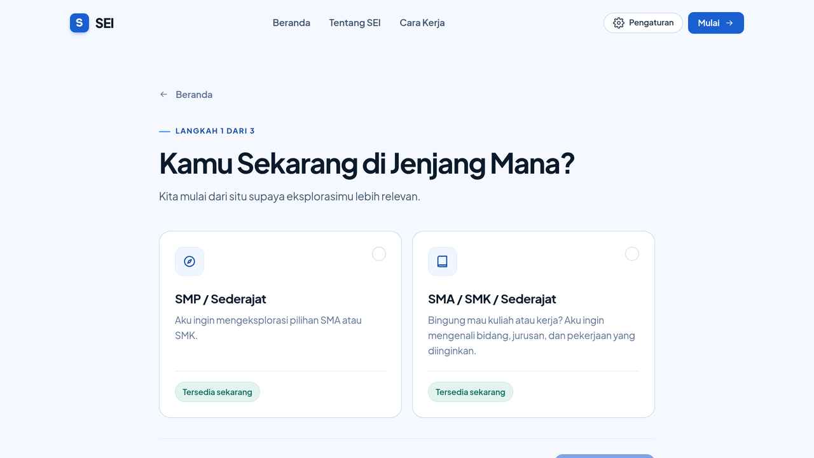
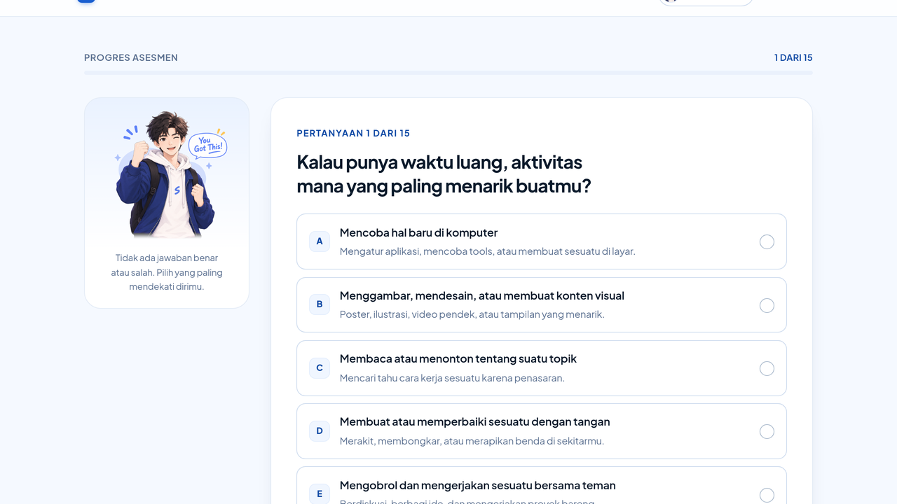
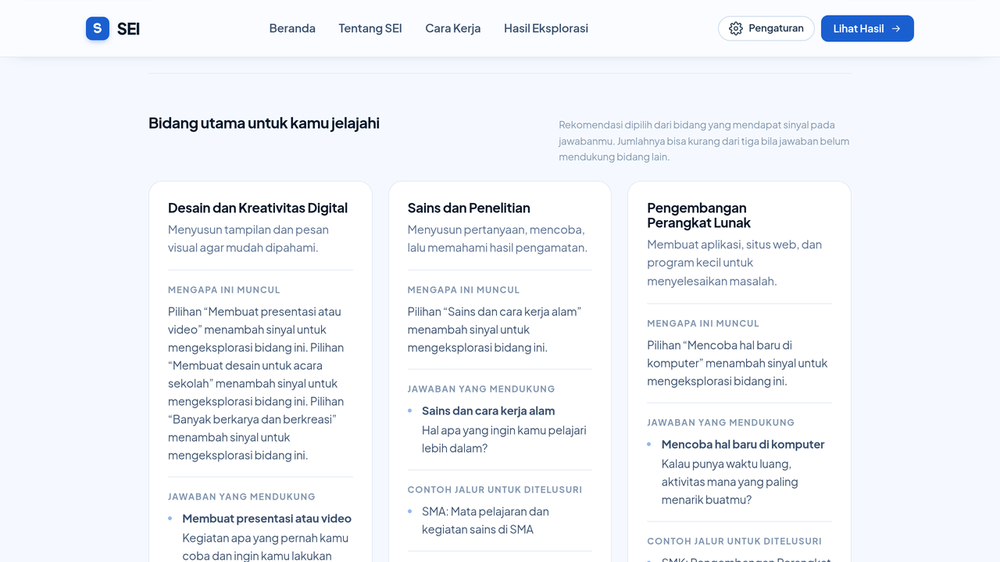
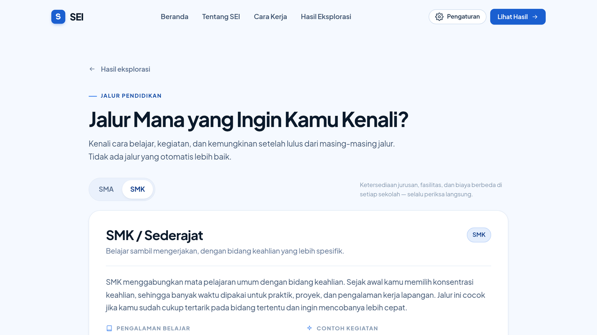
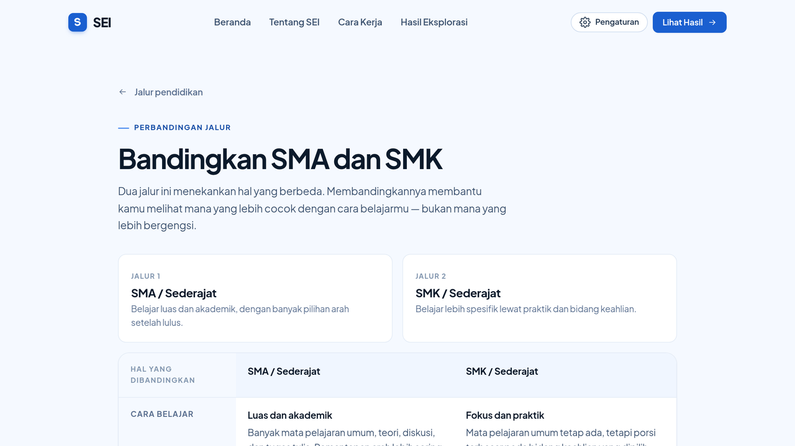
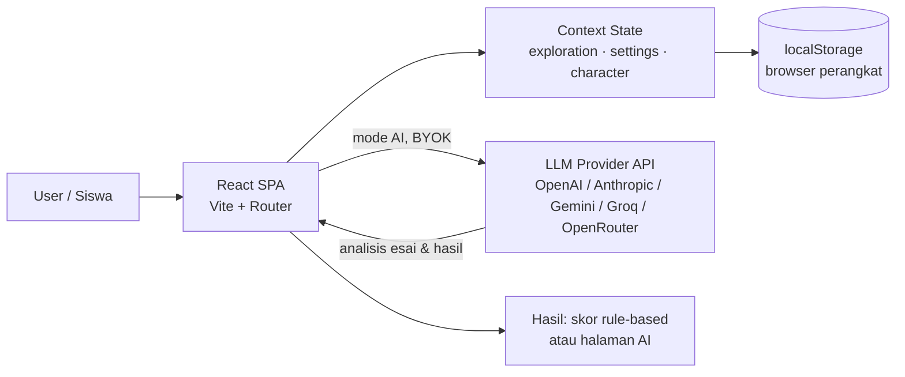

<div align="center">

<h1>
  
</h1>



[](https://sei-explore.netlify.app/)

[](#product-preview)
[](#key-features)
[](https://github.com/DzarelDeveloper/sei)

[Cara Kerja](#how-it-works) · [FAQ](#faq) · [Instalasi](#getting-started) · [Demo Juri](#deployment--demo-untuk-juri) · [Disclosure](DISCLOSURE.md)

</div>

**SEI adalah aplikasi web yang membantu siswa SMP, SMA, dan SMK memahami
minatnya sendiri — lalu memberi mereka cara nyata untuk menjelajahi
pilihannya.**

Alat refleksi, bukan tes bakat. Tidak ada warna, font, atau jurusan yang
dipaksakan — arah tetap milikmu. Tanpa akun, tanpa backend, tanpa data yang
dikirim ke server kami.

---

## What Does SEI Mean?

**SEI** adalah singkatan dari **Self Exploration Intelligence** — tiga kata
yang menjadi tujuan produk ini:

- **Self Exploration** — proses mengenali ketertarikan sendiri dan
  mengeksplorasi bidang yang ingin dipelajari, lewat asesmen interaktif yang
  ringan dan kontekstual.
- **Exploration** — membantu pengguna menemukan alternatif dan memahami
  pilihan pendidikan yang tersedia: bidang studi, jurusan, serta jalur SMA
  dan SMK beserta pertimbangannya.
- **Intelligence** — penggunaan informasi dari jawaban pengguna untuk
  menyusun rangkuman dan rekomendasi yang relevan, sehingga hasil yang
  diterima terhubung langsung dengan apa yang pengguna katakan sendiri.

## About SEI

Banyak siswa harus memilih — SMA atau SMK, jurusan apa, bidang apa — padahal
belum pernah diberi kesempatan mengenali minatnya sendiri. Pertanyaan itu
sering dijawab dengan tekanan lingkungan, bukan pemahaman pribadi.

SEI hadir untuk tahap *sebelum* keputusan itu. Lewat asesmen singkat dan
halaman hasil yang menjelaskan *mengapa* sebuah bidang muncul, pengguna diajak
menamai ketertarikannya, melihat alternatif yang relevan, dan mempersiapkan
pertanyaan yang tepat untuk orang tua, guru, atau BK.

Hasilnya adalah **bahan refleksi**, bukan vonis — dan karena alurnya bisa
diulang kapan saja, pemahaman diri yang berubah ikut terakomodasi. Memang
begitu proses mengenal diri bekerja.

## Product Preview

|   |   |   |
|---|---|---|
| <br>**Landing page** | <br>**Pemilihan jenjang** | <br>**Asesmen** |
| <br>**Hasil & rekomendasi** | <br>**Informasi jalur** | <br>**Bandingkan SMA & SMK** |

Setiap gambar bisa diklik untuk melihat ukuran penuh. Galeri lengkap —
termasuk Mode AI dan tampilan mobile — ada di
[Lihat seluruh screenshot dan alur aplikasi](docs/SCREENSHOTS.md).

## Key Features

- **Asesmen minat interaktif** — 15 pertanyaan (pilihan tunggal, pilih
  beberapa dengan batas, skala diri), didahului lima pertanyaan kecenderungan
  esai singkat sebagai konteks personal.
- **Tiga jenjang, dua jalur** — SMP serta SMA/SMK dengan pemilihan jalur;
  bank soal dan halaman hasil disesuaikan untuk masing-masing.
- **Rangkuman berbasis jawaban** — sinyal minat dirangkum dari jawaban yang
  kamu isi, lengkap dengan bukti jawaban yang mendukungnya.
- **Rekomendasi + alasan** — bidang dengan sinyal terkuat menjadi rekomendasi
  utama, dengan alasan yang menunjuk langsung ke jawabanmu sendiri.
- **Alternatif & jelajah bidang** — bidang lain tetap ditampilkan sebagai
  opsi, plus halaman jelajah per bidang (kegiatan, contoh jurusan, kampus,
  pekerjaan).
- **Informasi & perbandingan jalur** — halaman SMA vs SMK dengan tabel
  perbandingan, pertimbangan, dan daftar pertanyaan untuk diajukan ke sekolah.
- **Mode AI (bring-your-own-key)** — opsional: model AI menyusun soal
  personalisasi dan membaca jawabanmu, memakai API key milikmu sendiri.
- **Progres tersimpan lokal** — tanpa akun; tetap ada saat halaman dibuka
  kembali.
- **Responsif** — nyaman di desktop maupun mobile, dengan maskot pendamping
  yang bisa dipilih dan berganti pose sesuai konteks.

## How It Works

1. **Buka SEI** — langsung mulai, tanpa akun.
2. **Pilih jenjang** — SMP, atau SMA/SMK dilanjutkan memilih jalur.
3. **Kerjakan asesmen** — lima pertanyaan kecenderungan, lalu 15 pertanyaan
   sesuai alur. Progres tersimpan otomatis; bisa dilanjutkan kapan saja.
4. **Tinjau hasil** — rangkuman sinyal minat, rekomendasi bidang, beserta
   alasan dan bukti jawabannya.
5. **Jelajahi alternatif** — buka bidang lain yang relevan lewat halaman
   jelajah.
6. **Bandingkan jalur** — pelajari informasi SMA vs SMK sebagai bekal
   diskusi dengan orang tua atau guru.

## Assessment and Recommendations

SEI punya **dua mesin penilaian** yang bekerja berbeda, dan penting untuk
membedakannya:

**Mode Default — scoring lokal berbasis aturan.** Setiap opsi jawaban memiliki
pemetaan ke satu atau lebih dari lima bidang (perangkat lunak, jaringan,
desain, sains, elektronika). Jawaban menambah bobot sinyal; bidang dengan
sinyal terkuat menjadi rekomendasi utama. Seluruh perhitungan terjadi di
browser, deterministik, dan **bukan AI** — aturan penskoran sederhana yang
hasilnya selalu sama untuk jawaban yang sama.

**Mode AI — opsional, dengan API key milikmu.** Saat diaktifkan di
Pengaturan, SEI terhubung ke provider AI (OpenAI, Anthropic, Google Gemini,
Groq, atau OpenRouter — terdeteksi otomatis dari format key). Model menyusun
soal yang dipersonalisasi dari jawaban kecenderunganmu, lalu membaca jawaban
asesmen untuk menghasilkan rangkuman dan rekomendasi. Permintaan dikirim
langsung dari browser ke provider — tanpa server perantara milik SEI.

**Catatan penting.** Kedua mode menghasilkan **panduan eksplorasi**, bukan
diagnosis psikologis, bukan pengukuran bakat yang tervalidasi secara ilmiah,
dan bukan penentu masa depan.

## Technology Stack

Diverifikasi dari `package.json`:

| Kategori | Teknologi |
| --- | --- |
| UI library | React 18 + React DOM |
| Bahasa | TypeScript 5 (strict, project references) |
| Build & dev server | Vite 6 (`@vitejs/plugin-react`) |
| Routing | React Router 6 (SPA, BrowserRouter) |
| Styling | CSS kustom — design tokens berbasis custom properties |
| Tipografi | Plus Jakarta Sans & Instrument Serif (Fontsource, self-hosted) |
| State | React Context (progres, pengaturan, karakter) |

Aplikasi murni sisi klien: **tidak ada backend, tidak ada database**. Mode AI
menghubungkan browser langsung ke provider eksternal dengan key milikmu.

## Architecture / Data Flow



Catatan jujur: kotak `API` hanya dilalui ketika pengguna mengaktifkan Mode AI
dan menempelkan key miliknya sendiri; alur default berhenti di browser.

## Getting Started

Prasyarat: **Node.js 18+** dan **npm** (repo menyertakan `package-lock.json`).

```bash
git clone https://github.com/DzarelDeveloper/sei.git
cd sei
npm ci                            # instal dependency dari lockfile
npm run dev                       # http://localhost:5173
```

| Perintah | Keterangan |
| --- | --- |
| `npm run dev` | Development server Vite dengan HMR |
| `npm run build` | Typecheck (`tsc -b`) + build produksi ke `dist/` |
| `npm run preview` | Pratinjau hasil build |
| `npm run typecheck` | Pemeriksaan tipe TypeScript |
| `npm run docs:shots` | Regenerasi screenshot dokumentasi + smoke test |

Hasil build bersifat static — sajikan `dist/` di hosting apa pun dengan
fallback ke `index.html`.

## Deployment & Demo untuk Juri

- **Live URL:** https://sei-explore.netlify.app (auto-deploy dari branch `main`)
- **Versi terkunci:** tag `v1.0-submission` pada GitHub — commit hash yang
  dinilai tercatat di release/tag tersebut.
- **Tanpa login.** Semua fitur default dapat diuji langsung dari kondisi kosong:
  *Mulai → Pengaturan → Asesmen 15 soal → Hasil → Jelajah Jalur*.
- **Mode AI untuk penguji.** SEI memakai pola bring-your-own-key, jadi juri
  bisa menguji fitur AI dengan salah satu cara ini:
  1. Buka **Pengaturan → Mode AI**, tempel API key Groq/Gemini/OpenAI milik
     sendiri — provider gratis seperti Groq atau Gemini dapat didaftarkan
     dalam ±2 menit; **atau**
  2. Minta **kunci demo sementara** melalui kanal/form panitia (kunci dikirim
     di luar repository, sesuai ketentuan keamanan).
- Tidak ada secret, API key, maupun credential apa pun yang disimpan di
  repository ini — lihat `.env.example` (kosong, memang disengaja).

## Privacy and Limitations

- **Penyimpanan.** Jawaban, progres, preferensi mode/API key, dan pilihan
  karakter disimpan di `localStorage` browser (`sei.exploration.v1`,
  `sei.settings.v1`, `sei.character.v1`). Menghapus data browser = menghapus
  progres.
- **Mode Default.** Seluruh perhitungan di browser — jawaban tidak dikirim ke
  mana pun.
- **Mode AI.** Jawaban dikirim dari browser ke provider terpilih. Gunakan key
  milikmu sendiri, dan **hindari menulis data pribadi** (nama lengkap,
  alamat, identitas sekolah) ke dalam jawaban. Kebijakan privasi mengikuti
  provider masing-masing.
- **Batasan.** Rekomendasi belum tervalidasi secara psikometrik; informasi
  jalur bersifat umum — **verifikasi ke sekolah, kampus, atau sumber
  resmi** sebelum memutuskan.

## FAQ

Jawaban singkat untuk pertanyaan yang paling sering muncul — klik untuk membaca.

<details>
<summary>🧭 <strong>SEI bisa memprediksi masa depan saya, kan?</strong></summary>

<br>

Tidak — dan SEI tidak akan pernah mengklaim begitu. Yang SEI lakukan: merapikan
apa yang sudah kamu ketahui tentang dirimu, lalu menghubungkannya dengan pilihan
yang layak dieksplorasi. Prediksi itu urusanmu; SEI hanya memastikan kamu
memulai dari tempat yang tepat.

</details>

<details>
<summary>🧪 <strong>Berarti ini tes psikologi?</strong></summary>

<br>

Bukan. Tidak ada klaim validitas ilmiah di sini. Mode Default adalah penskoran
berbasis aturan — bukan instrumen psikometrik, tidak mengukur bakat, dan tidak
menegakkan diagnosis apa pun.

</details>

<details>
<summary>🔐 <strong>Harus bikin akun? Data saya dikirim ke mana?</strong></summary>

<br>

Tidak perlu akun, dan tidak ada server milik SEI. Semua jawaban dan progres
hidup di `localStorage` browser-mu. Di Mode Default, tidak ada satu bit pun
yang keluar dari perangkat. Di Mode AI, jawaban dikirim *langsung* dari browser
ke provider pilihanmu — jadi hindari menulis data pribadi di dalam jawaban.

</details>

<details>
<summary>🤖 <strong>Apa bedanya Mode AI dengan Mode Default?</strong></summary>

<br>

**Default** — skor lokal, deterministik, jalan tanpa internet.
**AI** — model menyusun soal yang dipersonalisasi dari jawabanmu lalu membaca
hasilmu untuk menyusun rekomendasi. Mode AI bersifat opsional dan memakai
API key milikmu sendiri (bring-your-own-key); tanpa key, SEI tetap berfungsi
penuh di Mode Default.

</details>

<details>
<summary>🗂️ <strong>Kenapa hasilnya cuma lima bidang?</strong></summary>

<br>

Lima bidang (perangkat lunak, jaringan, desain, sains, elektronika) adalah
titik berangkat yang dipetakan di bank soal — bukan daftar tertutup. Halaman
alternatif dan jelajah bidang dirancang supaya eksplorasi lanjut ke mana kamu
mau, bukan berhenti di lima kotak.

</details>

<details>
<summary>🎒 <strong>Saya SMP/SMA/SMK — apakah semuanya dapat bagian?</strong></summary>

<br>

Ya. Jenjang **SMP** punya bank soal dan halaman hasil sendiri; **SMA dan SMK**
berbagi alur dengan pemilihan jalur lebih dulu, hasil yang disesuaikan, plus
halaman perbandingan jalur untuk keduanya.

</details>

## Project Structure

```text
.
├── public/
│   ├── logo.svg / logo-mark.svg   # logo resmi SEI (mark "S" handwritten)
│   ├── favicon.svg / og-image.png # ikon & gambar share media sosial
│   ├── _redirects                 # SPA fallback untuk Netlify
│   └── images/sei/                # aset pose maskot (boy & girl)
├── src/
│   ├── components/                # UI: Navbar, Mascot, ResultCards, dll.
│   ├── data/                      # bank soal, aturan scoring, konten bidang & jalur
│   ├── pages/                     # 1 halaman per rute (landing → asesmen → hasil → jalur)
│   ├── services/                  # aiClient.ts (BYOK multi-provider) & alur Mode AI
│   ├── state/                     # Context: progres eksplorasi, pengaturan, karakter
│   ├── styles/                    # tokens.css, components.css, pages.css, base.css
│   └── App.tsx                    # definisi rute SPA
├── scripts/                       # tooling dokumentasi & verifikasi (headless Chrome)
├── docs/
│   ├── SCREENSHOTS.md             # galeri screenshot lengkap seluruh alur
│   ├── sei-banner.png             # banner README
│   ├── sei-wordmark.png           # wordmark judul README
│   └── screenshots/               # landing/ assessment/ results/ pathways/ mobile/
├── LICENSE                        # MIT — (c) 2026 Muhamad Dzarel Alghifari
├── DISCLOSURE.md                  # AI & Technology Disclosure (lomba)
├── .env.example                   # kosong by design — tidak ada secret
├── netlify.toml                   # konfigurasi deploy Netlify
└── vite.config.ts
```

---

> “SEI tidak memutuskan untukmu.
> Ia membereskan pilihanmu, lalu mengembalikan kendalinya kepadamu.”

---

## Team

**Muhamad Dzarel Alghifari** — peserta individu. Seluruh peran dipegang sendiri:
perancangan produk & UX, penulisan kode, kurasi konten pendidikan, pembuatan
aset visual (maskot + logo), dokumentasi, dan deployment.

## Third-party Resources & Credits

| Resource | Lisensi | Peran |
| --- | --- | --- |
| [Plus Jakarta Sans](https://fontsource.org/fonts/plus-jakarta-sans) & Instrument Serif (Fontsource) | SIL OFL 1.1 | Tipografi aplikasi |
| React, React Router, Vite, TypeScript | MIT | Fondasi aplikasi |
| [shields.io](https://shields.io) | — | Badge dinamis di README ini |
| Maskot, logo "S", banner, wordmark | buatan sendiri | Aset brand SEI — tidak memakai stok pihak ketiga |

Pengembangan dibantu **AI coding assistant** sebagai development tool; seluruh
kode di-review, diuji, dan dipertanggungjawabkan oleh penulis. Rincian lengkap
(termasuk pre-existing status proyek): **[DISCLOSURE.md](DISCLOSURE.md)**.

## Lisensi dan Pengembangan

SEI dirilis di bawah **[MIT License](LICENSE)** — bebas digunakan, dimodifikasi,
dan disebarluaskan, selama atribusi copyright tetap dicantumkan.

```text
Copyright (c) 2026 Muhamad Dzarel Alghifari
```

Kontribusi dipersilakan. Sebelum mengirim perubahan: jalankan
`npm run typecheck` dan `npm run build`, dan perbarui dokumentasi bila rute
atau perilaku berubah. Hindari klaim kemampuan prediktif atau validitas
ilmiah yang belum didukung evaluasi.

**Dokumentasi terkait:** [Galeri screenshot lengkap](docs/SCREENSHOTS.md)
